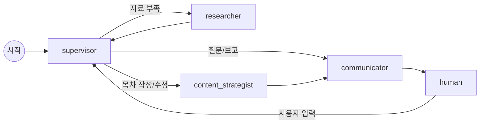

# book-agent

책 목차 작성을 돕는 대화형 AI 에이전트입니다. 요청을 받으면 자료를 조사하고, 목차를 쓰고, 진행 상황을 보고한 뒤 다음 지시를 기다립니다.
[LangGraph](https://langchain-ai.github.io/langgraph/)로 만든 멀티 에이전트 그래프이고, OpenAI 모델과 Tavily 웹 검색을 사용합니다.

```
User    : 초보자용 파이썬 입문서 목차를 5장 정도로 만들어 줘.

[supervisor] 다음 작업 -> researcher: 최신 파이썬 버전과 입문서 구성 조사
[researcher] 조사 완료 (1회차)
[supervisor] 다음 작업 -> content_strategist: 조사 내용을 바탕으로 5장 목차 작성

[content_strategist]
# 초보자를 위한 파이썬 입문
## 1장. 파이썬 시작하기
...

[communicator]
목차를 만들었습니다. 문법 설명을 늘릴까요, 실습 프로젝트를 늘릴까요?

User    : 마지막에 실전 프로젝트 장을 추가해 줘.
```

## 주요 기능

- **역할을 나눈 에이전트**: supervisor가 다음 할 일을 정하고, 조사·목차 작성·보고를 각 담당 노드에 맡깁니다.
- **근거 있는 목차**: researcher가 Tavily로 웹을 검색해 벡터 DB(Chroma)에 저장하고, 출처 URL이 붙은 요약을 남깁니다. 출처는 조사 노트에 제목·URL 목록으로 따로 저장되며, 검색 도구가 실제로 돌려준 문서만 남깁니다(LLM이 지어낸 URL은 제외).
- **대화 이어 가기**: 대화 상태를 SQLite 체크포인트에 저장합니다. 프로그램을 껐다 켜도 같은 `THREAD_ID`면 이전 대화를 이어 갑니다.
- **비용 안전장치**: 한 턴의 조사 횟수(`MAX_RESEARCH_ROUNDS`)와 검색 도구 호출 수(`MAX_TOOL_CALLS`)에 상한이 있습니다.
- **오류 처리**: 키·모델 설정 오류는 안내 후 종료하고, 한도 초과·네트워크 오류는 재시도한 뒤 대화를 계속합니다.

## 동작 구조



| 노드 | 하는 일 |
|---|---|
| `supervisor` | 대화·목차·조사 노트를 보고 다음 작업과 담당자를 정합니다(구조화 출력). 조사 한도에 닿으면 목차 작성으로 넘깁니다. |
| `researcher` | 하위 에이전트가 `retrieve`(벡터 DB)와 `web_search`(Tavily) 도구로 조사하고 출처가 붙은 요약을 남깁니다. |
| `content_strategist` | 요구 사항과 조사 노트로 마크다운 목차를 작성·수정해 `outline.md`에 저장합니다. |
| `communicator` | 사용자에게 변경점을 보고하고 다음 결정에 필요한 질문을 합니다. |
| `human` | 그래프를 멈추고(interrupt) 사용자 입력을 기다립니다. |

## 요구 사항

- Python 3.12
- [uv](https://docs.astral.sh/uv/)
- OpenAI API 키, Tavily API 키
- (선택) NVIDIA GPU + CUDA: 로컬 HuggingFace 임베딩을 쓸 때만 필요합니다.

## 설치

```bash
git clone https://github.com/kbigdata/book_agent.git
cd book_agent
uv sync                    # GPU 의존성(torch, sentence-transformers) 포함
uv sync --no-group gpu     # GPU 가 없는 PC: OpenAI 임베딩만 사용
```

## 설정

프로젝트 루트에 `.env` 파일을 만듭니다. `.env`는 git에 올라가지 않습니다.

```dotenv
# 필수
OPENAI_API_KEY=sk-...
TAVILY_API_KEY=tvly-...

# 선택 (기본값)
LLM_MODEL=gpt-5.5
EMBEDDING_PROVIDER=openai          # openai | huggingface(로컬 GPU)
HF_EMBEDDING_MODEL=BAAI/bge-m3
DEVICE=auto                        # auto | cuda | cpu
HF_TOKEN=hf_...                    # HuggingFace 모델 다운로드용
```

그 밖의 설정은 환경변수 또는 `.env`로 바꿀 수 있습니다(이름은 대문자).

| 설정 | 기본값 | 설명 |
|---|---|---|
| `DATA_DIR` | `data` | 목차·벡터 DB·검색 기록·체크포인트 저장 위치 |
| `THREAD_ID` | `book_001` | 대화 구분자. 다른 책을 쓰려면 바꿉니다. |
| `MAX_RESEARCH_ROUNDS` | `2` | 한 턴에서 조사할 수 있는 최대 횟수 |
| `MAX_TOOL_CALLS` | `6` | researcher 한 번의 검색 도구 호출 상한 |
| `SEARCH_TOP_K` | `5` | 벡터 DB 검색 결과 수 |
| `CHUNK_SIZE` / `CHUNK_OVERLAP` | `1000` / `100` | 웹 문서를 나누는 청크 크기 |
| `MAX_HISTORY_TOKENS` | `8000` | LLM에 넘기는 최근 대화의 토큰 상한 |
| `OPENAI_EMBEDDING_MODEL` | `text-embedding-3-large` | OpenAI 임베딩 모델 |
| `LLM_TIMEOUT` | `120` | OpenAI 호출 한 번의 응답 대기 시간(초) |
| `LLM_MAX_RETRIES` | `1` | OpenAI 클라이언트의 재시도 횟수. 한 호출이 멈출 수 있는 최대 시간은 `LLM_TIMEOUT × (LLM_MAX_RETRIES + 1)` |

잘못된 값이 있으면 시작할 때 `[설정 오류] .env 의 다음 값을 확인하세요: SEARCH_TOP_K`처럼 항목 이름을 알려 주고 종료합니다.

## 실행

```bash
uv run book-agent
```

- 요청을 입력하면 한 턴이 진행되고, 보고가 끝나면 다음 지시를 기다립니다.
- `q`, `quit`, `exit`로 종료합니다. 다시 실행하면 같은 `THREAD_ID`의 대화를 이어 갑니다.
- 답변 중 `Ctrl+C`를 누르면 그 요청만 멈추고 다음 입력을 받습니다.
- 새 책을 시작하려면 `THREAD_ID`를 바꿔 실행합니다(PowerShell: `$env:THREAD_ID='book_002'; uv run book-agent`).

실행 결과는 `DATA_DIR`(기본 `data/`)에 저장됩니다.

| 경로 | 내용 |
|---|---|
| `outline.md` | 현재 목차(마크다운) |
| `checkpoints.sqlite` | 대화 상태(체크포인트) |
| `chroma/` | 검색한 웹 문서의 벡터 DB |
| `resources/*.json` | Tavily 검색 원본 결과 |

입출력은 UTF-8로 고정됩니다. Windows PowerShell 5.1에서 출력을 변수나 파이프로 받을 때 한글이 깨지면 먼저 `[Console]::OutputEncoding = [Text.Encoding]::UTF8`을 실행하세요.

## 오류 처리

| 상황 | 동작 |
|---|---|
| API 키 오류, 모델 없음, 권한 없음 | 확인할 항목을 안내하고 종료 코드 1로 끝냅니다(재시도하지 않음). |
| 요청 한도 초과, 네트워크 오류, 서버 5xx | 자동으로 재시도하고, 그래도 실패하면 안내 후 대화를 계속합니다. |
| OpenAI 응답 시간 초과 | `LLM_TIMEOUT` 후 클라이언트가 `LLM_MAX_RETRIES`번 다시 시도하고, 그래도 실패하면 안내 후 대화를 계속합니다(그래프는 다시 시도하지 않음). |
| 크레딧 부족, 요청 거부(400) | 재시도 없이 안내하고 대화를 계속합니다. |
| 예상하지 못한 오류 | 짧게 안내하고 대화를 계속하며, traceback은 ERROR 로그로 남깁니다. |

오류로 턴이 중단되어도 대화 기록은 체크포인트에 남아 있어 다음 입력부터 이어서 진행됩니다.

## 테스트

```bash
uv run pytest           # 단위 테스트 (API 키·네트워크 불필요)
uv run pytest --live    # + 실제 OpenAI/Tavily 호출 테스트와 CLI 통합 테스트 (비용 발생)
```

| 종류 | 파일 | 내용 |
|---|---|---|
| 단위 | `tests/test_*.py` | 가짜 LLM·검색·임베딩으로 각 모듈과 그래프 흐름 검증 |
| 실제 API (`--live`) | `tests/test_live.py` | 실제 모델 응답, 구조화 출력, 임베딩, Tavily 검색, 한 턴 전체 흐름 |
| CLI 통합 (`--live`) | `tests/test_integration.py` | `book-agent` 명령을 별도 프로세스로 실행해 재시작 후 이어 가기, 오류 종료 등 확인 |

live 테스트도 저장 위치를 임시 폴더로 바꿔 실행하므로 `data/` 폴더는 건드리지 않습니다.

### 시나리오 보고서

각 테스트의 docstring에 시나리오(대상·구분·우선순위·사전조건·절차·기대결과)가 적혀 있습니다. 실행 결과와 합쳐 엑셀 보고서를 만들 수 있습니다.

```bash
uv run pytest --live --scenario-report=docs/unit_test_results.json
uv run --with openpyxl python scripts/build_test_report.py docs/unit_test_report.xlsx docs/unit_test_results.json
```

보고서(`docs/unit_test_report.xlsx`)에는 요약(모듈·구분·우선순위별 통과율), 시나리오 목록, 실행 환경 시트가 들어 있습니다. 결과 JSON을 여러 개 주면 하나로 합칩니다.

## 프로젝트 구조

```
src/book_agent/
├── __init__.py       # book-agent 명령 진입점
├── app.py            # 의존성 조립(Composition Root), 대화 루프, 출력
├── graph.py          # 노드 등록, 이동 경로, 재시도 정책
├── nodes.py          # supervisor / researcher / content_strategist / communicator / human
├── state.py          # 그래프 상태와 reducer
├── models.py         # TaskPlan(LLM 출력 스키마), Task, ResearchNote
├── context.py        # 실행 중 바뀌지 않는 의존성 묶음(AppContext)
├── prompts.py        # 프롬프트
├── services.py       # 웹 검색, 벡터 DB, 임베딩
├── tools.py          # researcher 도구(web_search, retrieve)
├── repositories.py   # 목차 저장소
├── errors.py         # 외부 API 오류 분류(안내 문구, 종료·재시도 여부)
├── settings.py       # 설정(.env)
└── device.py         # 연산 장치 선택(cuda/cpu)
scripts/
├── build_test_report.py   # 테스트 시나리오 보고서(xlsx) 생성
└── check_gpu.py           # GPU 개발환경 점검
tests/                     # 단위 / live / CLI 통합 테스트
```

GPU 환경 점검:

```bash
uv run python scripts/check_gpu.py           # PyTorch / CUDA
uv run python scripts/check_gpu.py --embed   # + 로컬 임베딩 모델 실행
```
