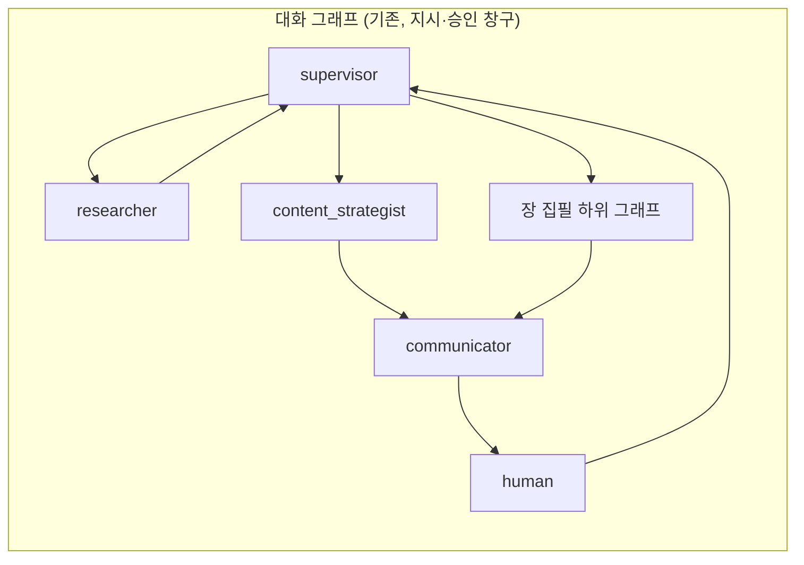
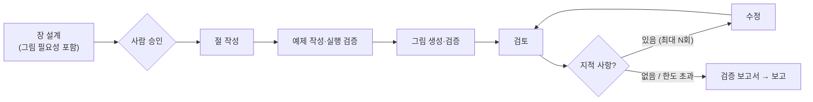

# 01. 책 완성 과정과 구조

## 1. 책 완성에 필요한 단계

`chapter_writer` 하나만으로는 책이 완성되지 않는다. 책 한 권에는 6단계가 필요하다.

| 단계 | 산출물 | 현재 구현 |
|---|---|---|
| ① 기획 | 기획서(독자층, 선수 지식, 학습 목표, 범위, 대상 Python·라이브러리 버전), 문체 가이드 | 없음 |
| ② 목차 | 장·절 구조 | **있음** |
| ③ 장 설계 | 장별 학습 목표, 절별 요점, 예제 목록, 그림 목록, 연습문제, 프로젝트 단계 | 없음 |
| ④ 집필 | 절 본문, 예제 코드, 그림 원본, 장 요약 | 없음 |
| ⑤ 검증·수정 | 장별 검증 보고서, 수정본 | 없음 |
| ⑥ 조립·출판 | 서문, 부록, 용어집, 참고문헌, 찾아보기, `book.md` / docx / pdf | 없음 |

가장 중요한 빈틈은 **③ 장 설계**다. 장 설계 없이 절을 바로 쓰면 개념 순서가 꼬이고, 예제가 겹치고,
프로젝트가 아직 배우지 않은 내용을 쓰게 된다. 기획서에서 학습 목표와 프로젝트를 먼저 정하고,
그 목표에 필요한 개념을 장에 배치하는 **역방향 설계**로 진행한다.

## 2. 역할 분담

| 역할 | 방식 | 하는 일 |
|---|---|---|
| `book_planner` | LLM | 기획서·문체 가이드 작성 (사람 승인) |
| `content_strategist` | LLM (기존) | 목차 작성·수정 |
| `chapter_planner` | LLM | 장 설계서 작성, 그림 제안(필요성 명세 포함) (사람 승인) |
| `section_writer` | LLM | 절 본문 작성 |
| `code_author` | LLM | 예제·프로젝트 코드와 테스트를 파일로 작성 |
| `figure_writer` | LLM | 추출·실행으로 만들 수 없는 그림의 원본 작성 |
| `figure_reviewer` | LLM | 그림 필요성 독립 검토, 그림·코드·본문 일치 검토 |
| `reviewer` | LLM | 사실 근거, 선행 개념, 문체, 학습 목표 달성 평가 |
| `code_runner` | **코드** | 격리 실행, 출력 비교, 테스트, lint, 결정성 검사 |
| `figure_builder` | **코드** | 그림 추출·실행·렌더링·기술 검증 |
| `assembler` | **코드** | 코드·그림 삽입, 번호·캡션, 교차 참조, 책 조립 |

## 3. 그래프 구조





- 장 하나에 수십 단계가 있으므로 하위 그래프로 묶는다. supervisor 가 단계마다 판단하면
  현재 `recursion_limit=40` 에 금방 닿고 LLM 호출 비용도 늘어난다.
- 작업 대상은 `TaskPlan` 에 `target: str | None` 필드로 받는다(예: `"2"` = 2장, `"2.3"` = 2장 3절, 해당 없음 `null`).
  OpenAI strict 모드에서 동작을 확인했다(실험 A). 예전 체크포인트 호환을 위해 `Task` 쪽에만 기본값 `None` 을 둔다.
- 절 작성은 절마다 LLM 을 한 번 호출하고 그때그때 저장한다. 같은 작업이 재시도되면 이미 쓴 절은 건너뛴다
  (그래프 재시도 정책은 노드 전체를 다시 실행하므로).
- 목차는 `outline.md` 의 제목(`##` 장, `###` 절)을 그대로 읽어 번호를 붙인다. 사용자가 파일을 직접 고쳐도 반영된다.

## 4. 저장 구조

```
data/book/
├── plan.md  style_guide.md  outline.md  glossary.md
├── chapters/ch03/
│   ├── plan.md          # 장 설계서 (학습 목표, 절 요점, 예제·그림 목록, 프로젝트 단계)
│   ├── ch03.md          # 원고 (코드·그림은 include 표시만)
│   └── review.md        # 검증 보고서
├── code/ch03/           # 예제 코드와 실행 결과 (.py, .out)
├── figures/ch03/        # 그림 명세(.yaml)와 원본(.json, .mmd)
├── projects/todo/step03/  tests/
├── theme/               # Mermaid 테마, matplotlib 설정, 글꼴
├── build/               # 렌더링 결과 (git 제외, 해시 캐시)
└── manifest.json        # 절·예제·그림·프로젝트 단계 상태, 도입한 개념, 승인 여부, 의존 해시
```

- 파일이 기준 데이터다. 그래프 상태에는 진행 현황을 넣지 않고 매번 저장소에서 읽는다(현재 목차 처리 방식과 같다).
- 목차가 바뀌면 저장된 절 제목과 비교해 다른 곳을 `outdated` 로 표시하고 사용자에게 알린다. 자동으로 다시 쓰지 않는다.

## 5. 새 설정 후보

| 설정 | 기본값(안) | 설명 |
|---|---|---|
| `LLM_TIMEOUT` | `180` | LLM 호출 타임아웃(초) — 0단계 |
| `MAX_CHAPTERS_PER_TURN` | `1` | 한 턴에 쓰는 장 수 |
| `MAX_REVISIONS` | `2` | 검토 → 수정 반복 한도. 넘으면 사람에게 넘김 |
| `SECTION_TARGET_CHARS` | 보류 | 절당 목표 분량 |
| `WRITER_TOP_K` | `4` | 절 작성 시 벡터 DB 에서 가져올 자료 수 |
| `CODE_RUN_TIMEOUT` | `10` | 예제 실행 시간 제한(초) |
| `SANDBOX` | `auto` | `process` / `docker` / `auto`(Docker 가 켜져 있으면 사용) |

화면에는 본문 전체를 흘리지 않고 `[chapter_writer] 2장 2.1 작성 완료 (1,480자)` 같은 진행 줄만 출력한다.

## 6. 비용과 시간 (추정)

- 장 하나: LLM 약 20~35회 (장 설계 1, 절 6 × (작성 1 + 검토 1), 예제 4~6, 그림 검토, 수정 최대 2, 요약 1)
- 12장 책: 약 300~400회
- 실험에서 측정한 절 작성 응답 시간(8~14초) 기준으로 장 하나에 순수 작성만 5~10분, 검토·수정을 더하면 그 이상
- 몇 차례 실험으로 계산한 대략값이다. 1단계 구현 후 장 하나를 실제로 써서 다시 측정한다.

## 7. 로드맵

| 단계 | 내용 | 완료 기준 |
|---|---|---|
| **0** | LLM 타임아웃 추가 | 멈춤 없이 타임아웃 오류 안내 |
| **1. 집필 기반** | 기획서·문체 가이드, 장 설계서, 절 작성(구조 검증·재요청), 예제 파일 분리·실행·결정성 검증, 실행 결과 텍스트 삽입, Mermaid 렌더링·수정 반복, 그림 명세·번호·캡션, 그림 필요성 검토, 책 테마, 사람 승인 | 짧은 장 하나: 모든 예제 실행·출력 일치, 모든 그림 렌더링·필요성 승인 |
| **2. 검증 강화** | 출처 근거 검사, 선행 개념·용어 검사, 검토 → 수정 반복, 장별 검증 보고서, 그림 내용 일치·가독성·참조 검사, 집필 후 그림 재검토, 실행 추적 표, matplotlib 그래프 | 장마다 검증 보고서 생성, 지적 사항 수정 |
| **3. 프로젝트** | 대단원별 프로젝트 설계, 단계별 완성본과 pytest, 연습문제와 정답, 클래스도·폴더 트리·ERD 자동 추출 | 모든 단계 테스트 통과 |
| **4. 조립·출판** | `book.md` 조립, 서문·부록·용어집·참고문헌, 출력 형식별 그림 변환, 흑백 점검, docx/pdf, 필요 시 GUI·웹 화면 캡처 | 전체 책 파일 생성 |

1단계 테스트 계획: 단위(목차 해석, 저장소, 가짜 LLM 노드, 재시도 시 건너뛰기, `target` 라우팅, 그림 변환기),
live(짧은 절 하나 실제 작성), CLI 통합("1장 써 줘" → 파일 생성 → 재시작 후 이어 쓰기).
